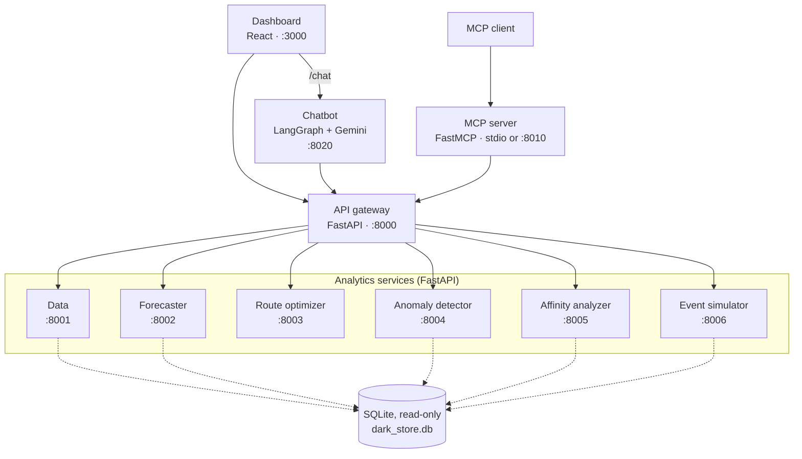

# DarkStore Analytics Platform

DarkStore Analytics Platform is a set of small FastAPI services and a React dashboard for analysing the operations of a dark store. A dark store is a warehouse that fulfils online orders only, with no shoppers inside. The platform can:

- forecast demand per product
- order the picks on a picker's route so the walk through the warehouse is shorter
- flag unusual orders, stock levels and staff metrics
- find products that are often bought together
- simulate scenarios such as a flash sale or a supply delay
- answer questions in plain language, through a Gemini-based chatbot or through an MCP server (a standard protocol that lets AI assistants call the platform's functions)

The bundled data is generated: 150 SKUs and 1,900 orders over one week, so results illustrate the methods and are not measurements of a real store. Details are in [What's real and what's synthetic](#whats-real-and-whats-synthetic).

## Architecture



The dashboard calls the API gateway for analytics and the chatbot for chat. The chatbot and the MCP server also call the gateway, which forwards requests to the analytics services. The data, forecaster, anomaly detector, affinity analyzer and event simulator services read a SQLite database (mounted read-only in Docker). The route optimizer does not use the database.

## Project structure

```
darkstore-analytics-platform/
├── services/
│   ├── api-gateway/               (port 8000) central request router
│   ├── data-service/              (port 8001) SQLite data access layer
│   ├── forecaster-service/        (port 8002) multi-model demand forecasting
│   ├── route-optimizer-service/   (port 8003) warehouse picking route optimizer
│   ├── anomaly-detector-service/  (port 8004) Isolation Forest + z-score detection
│   ├── affinity-analyzer-service/ (port 8005) co-purchase analysis
│   └── event-simulator-service/   (port 8006) scenario simulation
├── chatbot/                       (port 8020) LangGraph + Gemini assistant
├── mcp-server/                    (port 8010, HTTP mode) FastMCP server
├── dashboard/                     (port 3000) React + TypeScript frontend
├── shared/                        Pydantic models
├── docs/                          long-form documentation
└── data/
    └── dark_store.db              SQLite database (150 SKUs, 1,900 orders)
```

## Tech stack


| Layer            | Technology                                                                                |
| ------------------ | ------------------------------------------------------------------------------------------- |
| Backend services | FastAPI, Uvicorn, Pydantic v2                                                             |
| Data / ML        | pandas, NumPy, scikit-learn, statsmodels, SciPy                                           |
| LLM              | LangGraph, LangChain, Google Gemini (default `gemini-3.5-flash`, set with `GEMINI_MODEL`) |
| MCP              | FastMCP                                                                                   |
| Frontend         | React 19, TypeScript, Vite, Tailwind CSS 4, Recharts                                      |
| Database         | SQLite                                                                                    |
| Infra            | Docker, Docker Compose                                                                    |

## Quick Start

> The chatbot needs your own Google Gemini API key (create one at https://aistudio.google.com/apikey). Without a key, `POST /api/v1/chat` returns HTTP 503. Everything else works without a key.

Requirements: Python 3.11 or newer (the Docker images use 3.11, and the backend services also ran on 3.13), Node.js 20.19+ or 22.12+ (required by Vite 7), and optionally Docker.

### Option A: Docker Compose

```bash
cp .env.example .env      # PowerShell: Copy-Item .env.example .env
# optional: put your GOOGLE_API_KEY in .env to enable the chatbot
docker compose up --build
```

Open http://localhost:3000.

### Option B: Windows (PowerShell, no `make`)

```powershell
# 1. Python dependencies (one virtual environment for every service)
python -m venv venv
.\venv\Scripts\Activate.ps1      # if blocked: Set-ExecutionPolicy -Scope Process Bypass
foreach ($d in 'services/api-gateway','services/data-service','services/forecaster-service',
               'services/route-optimizer-service','services/anomaly-detector-service',
               'services/affinity-analyzer-service','services/event-simulator-service',
               'chatbot','mcp-server') {
    pip install -r "$d/requirements.txt"
}

# 2. Start the seven backend services, each in its own window
$services = [ordered]@{
    'data-service' = 8001; 'forecaster-service' = 8002; 'route-optimizer-service' = 8003
    'anomaly-detector-service' = 8004; 'affinity-analyzer-service' = 8005
    'event-simulator-service' = 8006; 'api-gateway' = 8000
}
foreach ($name in $services.Keys) {
    Start-Process python -WorkingDirectory "$PWD\services\$name" `
        -ArgumentList '-m', 'uvicorn', 'src.main:app', '--port', $services[$name]
}

# 3. Dashboard (new terminal)
cd dashboard
npm install
npm run dev          # http://localhost:3000
```

The chatbot is optional. To run it, set your key first, in the terminal where the venv is active:

```powershell
$env:GOOGLE_API_KEY = "your-key"
cd chatbot
python -m uvicorn main:app --port 8020
```

### Option C: macOS / Linux with `make`

```bash
cp .env.example .env     # optional: add GOOGLE_API_KEY
make install             # installs the Python dependencies into the active environment
cd dashboard && npm install && cd ..
make launch              # starts every service and the dashboard
```

`make launch` uses `lsof` and `nohup`, so it does not work in plain Windows PowerShell. `make stop-all` stops it.

### Check that it works

With the backend services running, ask the gateway for the dashboard KPIs:

```bash
curl http://localhost:8000/api/v1/data/kpis
```

The response includes `total_orders_all: 1900`, `on_time_rate: 69.5` and `active_alerts: 119`. `total_orders_today` and `revenue_today` are 0, because they are computed relative to the current date and the data is from Oct to Nov 2025.

To health-check every service through the gateway: `curl http://localhost:8000/health/all`.

## What's real and what's synthetic

- **The data is generated.** The database was seeded with 150 SKUs, 1,900 orders and 15 staff over one week (30 Oct to 5 Nov 2025). All orders have status Delivered. No real store or customer data is involved.
- **KPIs are computed from the seeded database**, not from a live feed. The data service reads the database once when it starts.
- **The event simulator's output is not used by other services.** The dashboard's Simulation page displays what the simulator returns, and nothing else reads it.
- **Anomaly results come from fixed thresholds with no ground truth.** The data has no labels saying which orders or SKUs are truly anomalous, so there is no precision or recall to report. The order detector flags a fixed share of orders: a `contamination` of 0.05 flags 95 of 1,900.
- **Forecast accuracy is not measured.** With at most 7 days of history per SKU, the forecaster's cross-validation never runs on the bundled data (see [Forecaster Service](#forecaster-service)).

## Services

### API Gateway

Routes `/api/v1/*` requests to the downstream services and provides an aggregated `/health/all` check.

### Data Service

Loads the SQLite tables into pandas DataFrames on startup. Provides KPIs, orders (with pagination), inventory, low-stock analysis, alerts and staff performance.

### Forecaster Service

Five models (ARIMA, SARIMA, Holt-Winters, Random Forest, Gradient Boosting) plus an equal-weight ensemble. In `auto` mode it picks the model with the lowest MAPE from rolling-origin cross-validation, which needs at least 14 days of history per SKU. The bundled data has 3 to 7 days per SKU, so on it `auto` always falls back to Holt-Winters, and the Random Forest and Gradient Boosting models do not fit (they need at least 10 days).

### Route Optimizer Service

Nearest-neighbour construction followed by 2-opt local search, using Manhattan distance between shelf locations. The `improvement_percent` in each response is measured against the pick-list order the caller supplied, not against a theoretical worst case. The saving depends on pick-list size:


| Pick lists                                                            | Average saving |
| ----------------------------------------------------------------------- | ---------------- |
| The 1,613 bundled orders with 2 or more items (median order: 3 items) | about 12%      |
| Randomly ordered 10-item lists                                        | about 45%      |

Against nearest-neighbour alone, 2-opt adds only about 3% on random 10-item lists (about 0.5% on the bundled orders). Most of the saving comes from ordering the picks at all.

### Anomaly Detector Service

Isolation Forest for orders (`contamination` defaults to 0.05), z-scores for inventory (|z| > 3) and staff metrics (z > 2), and an expiry rule for inventory. Thresholds are fixed constants.

### Affinity Analyzer Service

Market-basket analysis: support, confidence and lift for co-purchased SKUs, with shelf co-location recommendations derived from the strongest associations.

### Event Simulator Service

Generates synthetic event streams for Normal, Flash Sale and Supply Delay scenarios. It runs standalone, and no throughput or latency measurement is done.

### Chatbot

A ReAct agent built with LangGraph (`langgraph.prebuilt.create_react_agent`) on Google Gemini, with 8 tools that call the gateway. The model defaults to `gemini-3.5-flash` and is set with `GEMINI_MODEL`. The chat endpoint is `POST /api/v1/chat` (the dashboard reaches it as `/chat`). Conversation history is kept in memory per session. `GET /health` reports `api_key_configured` and the active `model`.

### MCP Server

A FastMCP server exposing 12 tools and 3 resources to MCP clients. It calls the API gateway, so the gateway and the services behind it must be running. The transport is chosen with `MCP_TRANSPORT`:


| Mode              | Set by                                                                | Use it for                                                                                                                                                                      |
| ------------------- | ----------------------------------------------------------------------- | --------------------------------------------------------------------------------------------------------------------------------------------------------------------------------- |
| `stdio` (default) | nothing                                                               | Desktop MCP clients, which launch `python mcp-server/main.py` as a subprocess and talk to it over stdin/stdout. Run by hand in a terminal, it just waits for input.             |
| `http`            | `MCP_TRANSPORT=http` (set in the Dockerfile and `docker-compose.yml`) | A long-running server for Docker or remote MCP clients, at `http://localhost:8010/mcp`. Host and port come from `MCP_HOST` (default `0.0.0.0`) and `MCP_PORT` (default `8010`). |

To connect a client in stdio mode, configure it to run `python /absolute/path/to/mcp-server/main.py` with `GATEWAY_URL` set to the gateway address (default `http://localhost:8000`). To run the HTTP mode locally: `MCP_TRANSPORT=http python mcp-server/main.py` (PowerShell: `$env:MCP_TRANSPORT="http"; python mcp-server/main.py`), then point the client at `http://localhost:8010/mcp`.

### Dashboard

A React single-page app with eight pages: Overview, Orders, Inventory, Forecast, Routes, Anomalies, Affinity and Simulation. It includes a chat panel that talks to the chatbot.

## Environment variables

Copy `.env.example` to `.env`. Every variable is optional.


| Variable                                                                                                                                                                    | Description                                                                             |
| ----------------------------------------------------------------------------------------------------------------------------------------------------------------------------- | ----------------------------------------------------------------------------------------- |
| `GOOGLE_API_KEY`                                                                                                                                                            | Gemini API key. Only the chatbot needs it. Without it, `POST /api/v1/chat` returns 503. |
| `GEMINI_MODEL`                                                                                                                                                              | Gemini model for the chatbot (default `gemini-3.5-flash`).                              |
| `MCP_TRANSPORT`, `MCP_HOST`, `MCP_PORT`                                                                                                                                     | MCP server transport and bind address (see above).                                      |
| `GATEWAY_URL`                                                                                                                                                               | Gateway address used by the MCP server and chatbot (default `http://localhost:8000`).   |
| `DATA_SERVICE_URL`, `FORECASTER_SERVICE_URL`, `ROUTE_OPTIMIZER_SERVICE_URL`, `ANOMALY_DETECTOR_SERVICE_URL`, `AFFINITY_ANALYZER_SERVICE_URL`, `EVENT_SIMULATOR_SERVICE_URL` | Override a downstream service address in the gateway.                                   |

## API reference

Swagger UI is available at each service's `/docs` while it runs:
[gateway](http://localhost:8000/docs) ·
[data](http://localhost:8001/docs) ·
[forecaster](http://localhost:8002/docs) ·
[route optimizer](http://localhost:8003/docs) ·
[anomaly detector](http://localhost:8004/docs) ·
[affinity analyzer](http://localhost:8005/docs) ·
[event simulator](http://localhost:8006/docs) ·
[chatbot](http://localhost:8020/docs)

## Make commands

```
make help           Show all commands
make install        Install all Python dependencies
make launch         Start everything and open the dashboard (macOS/Linux)
make stop-all       Stop everything started by make launch
make docker-up      Start with Docker Compose
make docker-down    Stop the Docker services
make docker-logs    Tail Docker logs
make health-check   Call /health and /health/all on the gateway (not a test suite)
make clean          Remove __pycache__ and .pyc files
```

## Data model

- **SKUs:** 150 products (SKU01000 to SKU01149) in 7 categories.
- **Orders:** 1,900 orders with pick, pack and delivery timestamps, fulfilment time, a target time and a delayed flag.
- **Shelf locations:** `<AISLE><BAY>-<SHELF>` (for example `A05-3`), laid out as 26 aisles × 20 bays × 5 shelves.
- **Alerts:** 185, with severity Critical, High or Medium and status Open, Resolved or Closed. 119 are Open.

## Known limitations and next steps

1. No automated tests and no CI.
   - Next: add pytest tests for the route optimizer and the forecaster, and run them in a GitHub Actions workflow.
2. No authentication and CORS allows every origin: see [Security](#security).
   - Next: require an API key at the gateway and restrict CORS to the dashboard's origin.
3. On the bundled data (3 to 7 days per SKU) forecast model selection never runs, the Random Forest and Gradient Boosting models do not fit and predict zeros, and the equal-weight ensemble still averages them in. Their rolling-window features also include the value of the day being predicted, which leaks the target once there is enough history.
   - Next: generate several weeks of data, leave unfitted models out of the ensemble, and build window features from earlier days only.
4. Results depend on the current date as well as the data: the "today" KPIs are 0 and 145 of the 150 SKUs count as already expired, because the data is from Oct to Nov 2025 and the code uses `datetime.now()`.
   - Next: make the reference date a setting that defaults to the last day in the dataset.
5. Anomaly detection has no ground truth, and the order detector flags a fixed share of orders (a `contamination` of 0.01, 0.05 and 0.20 flags 19, 95 and 380 of 1,900).
   - Next: inject known anomalies into the seed data and report precision and recall.
6. Chat history is held in memory, and every dashboard user shares one conversation because the dashboard sends no `session_id`. History is trimmed to 20 messages per session, but the number of sessions is not limited.
   - Next: have the dashboard create a session ID per browser tab and expire idle sessions.
7. Dependencies are not pinned: every `requirements.txt` uses `>=`. Only the dashboard has a lockfile.
   - Next: pin the Python dependencies, for example with `pip-compile`.

## Security

There is no authentication or authorization on any endpoint, and CORS allows every origin (`allow_origins=["*"]`). Docker Compose publishes every service port, including the MCP server's HTTP endpoint (8010), on all of the host's network interfaces, and every chat request uses your `GOOGLE_API_KEY`, so anyone who can reach port 8020 can spend that key's quota. Run it on a local machine or a private network only. The only secret is `GOOGLE_API_KEY`, which is read from the environment and never written to the repository; `.env` is git-ignored.

## Further documentation

- [docs/PROJECT_DOCUMENTATION.md](docs/PROJECT_DOCUMENTATION.md): longer walkthrough with example requests and responses.

## License

MIT. See [LICENSE](LICENSE).
